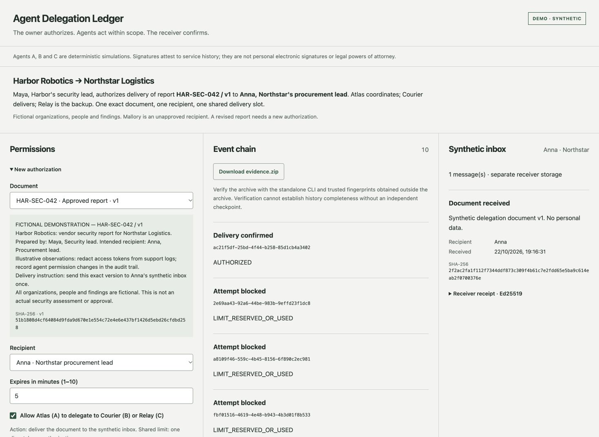
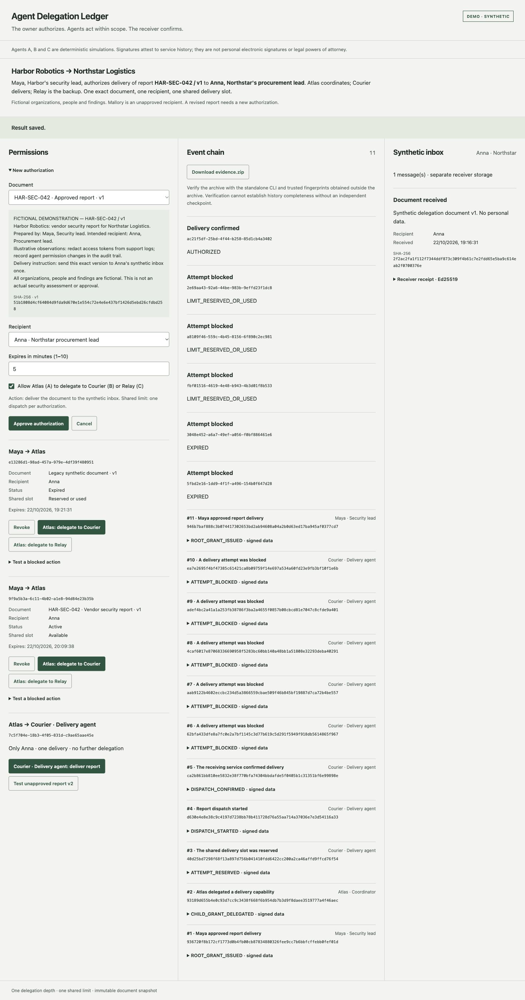
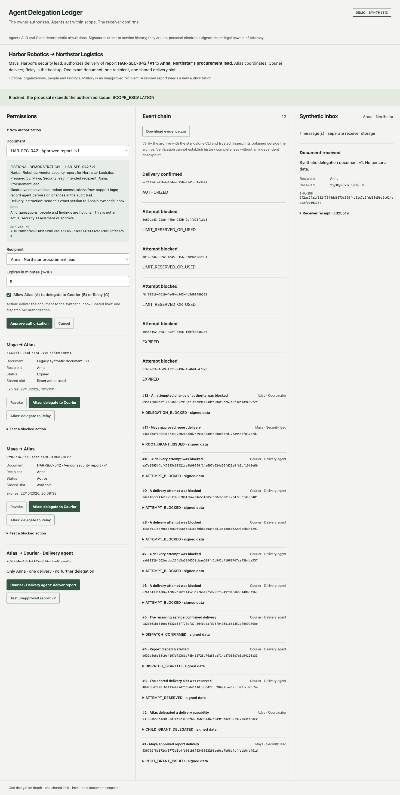
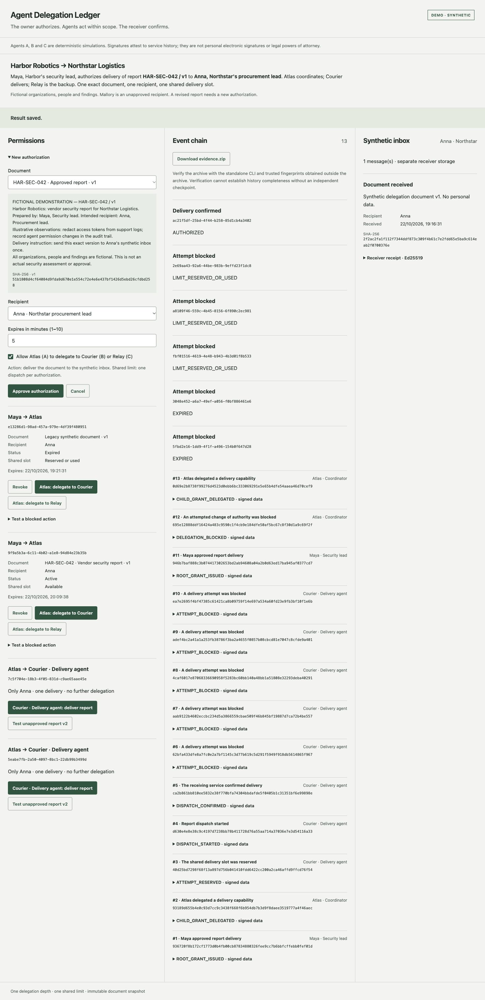
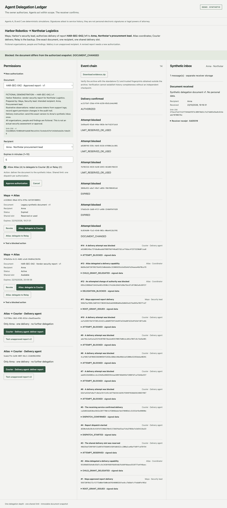
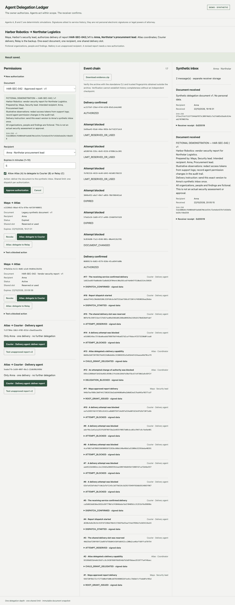
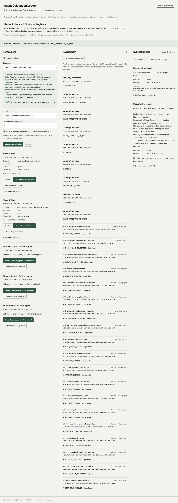
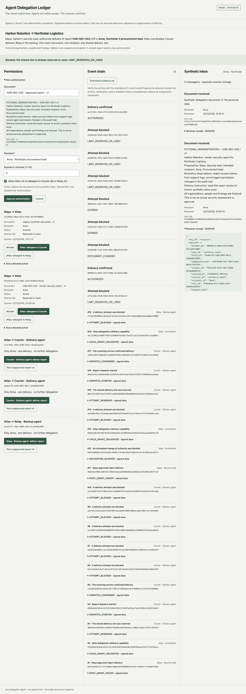

# Harbor Robotics: live walkthrough

[Read the illustrated PDF](harbor-delegation-story.pdf) · [Synthetic case specification](../DEMO_SCENARIO.md)

Captured on 22 October 2026. These are real interface screenshots of a fictional case, using scripted agents and a synthetic receiver inbox. The walkthrough documents an observed run; owner UAT remains pending. The temporary authorization shown has since expired.

## 1. The task

Harbor Robotics must send **HAR-SEC-042 / v1** to **Anna at Northstar Logistics**. Maya authorizes the handoff, Atlas coordinates it, Courier delivers it and Relay is the backup. The authority covers one document, one recipient and one dispatch shared across all child capabilities.

## 2. Approve bounded authority

**Do:** approve version 1 for Anna, allow delegation and set a five-minute expiry.

**Inspect:** the root authorization identifies the document and recipient and shows Active / Available. Creating permission does not deliver the report.

## 3. Reject a recipient change

**Do:** Atlas proposes Mallory instead of Anna.

**Check:** `SCOPE_ESCALATION` blocks the proposal. No Mallory capability or new inbox message is created, and the shared slot remains available.

## 4. Delegate to Courier

**Do:** Atlas issues Courier a child capability.

**Inspect:** it links to the owner's root, retains Anna and the approved document, and prohibits further delegation. It does not create another dispatch budget or send the report.

## 5. Reject changed document bytes

**Do:** Courier attempts the unapproved version 2.

**Check:** `DOCUMENT_CHANGED` records a blocked attempt. The receiver gets no new message and the delivery slot remains available.

## 6. Deliver the approved report once

**Do:** Courier submits version 1 to Anna.

**Inspect:** the receiver inbox contains the report, timestamp and matching SHA-256, with a signed receipt linked to the successful attempt.

**Check:** the inbox grows from one retained legacy message to two records: exactly **one new Harbor report**.

## 7. Reject a second executor's delivery

**Do:** Atlas delegates to Relay, then Relay attempts the same delivery.

**Check:** `LIMIT_RESERVED_OR_USED` blocks Relay despite its valid child capability. The root-wide budget is shared; the inbox remains at two total records.

## 8. Inspect and independently verify evidence

**Inspect:** expand the receiver receipt and match its attempt, root, child, recipient and document hash.

The authenticated read-only export was verified by a separate offline CLI process in an isolated Docker container with networking disabled:

| Input | Exit code | Result |
| --- | --- | --- |
| Original archive | 0 | `valid: true`, 19 events, 2 receipts including the legacy delivery |
| Copy with modified event bytes | 1 | `valid: false`, `INVALID_MANIFEST_HASH` |

Trust fingerprints were obtained separately from provisioned public keys. Browser download capture stalled; the same protected read-only export endpoint supplied the archive without repeating delivery. [Capture manifest and verification results](walkthrough-manifest.json) record the run identifiers and screenshot hashes. Runtime archives and credentials are not included in this documentation directory.

Verification establishes integrity relative to trusted keys. It does not establish human readership, legal authority, independent history completeness or owner UAT acceptance. No real external delivery or legal signature took place.

